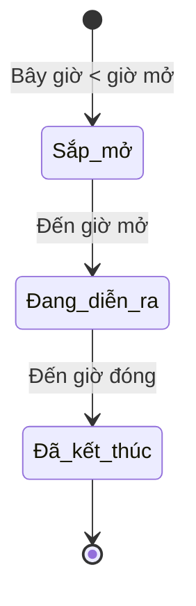

# Workflow vận hành đấu giá đồng hồ

Workflow này dùng cho plugin `Luxury Watches Auctions` và trang `/dau-gia/`.

## 1. Chuẩn bị sản phẩm

1. Tạo sản phẩm WooCommerce với SKU duy nhất.
2. Gắn ảnh đại diện rõ mặt số, tên sản phẩm, mô tả và danh mục Nam/Nữ.
3. Đặt tồn kho là `1` và bật chế độ bán riêng lẻ.
4. Không công bố phiên nếu ảnh, giá niêm yết hoặc SKU còn thiếu.

## 2. Tạo phiên đấu giá

Mỗi phiên phải có sản phẩm liên kết, mã phiên duy nhất, giá niêm yết, giá khởi điểm, bước giá, giá dự trữ, ảnh đại diện và khoảng thời gian hợp lệ.

Script `php scripts/add_auction_collection.php` tạo hoặc cập nhật bộ năm phiên mẫu. Script dùng SKU và slug nên có thể chạy lại mà không sinh bản ghi trùng.

## 3. Vòng đời phiên

Trạng thái được tính trên máy chủ theo múi giờ WordPress. Giao diện chỉ hiển thị bộ đếm; quyền nhận giá luôn do máy chủ quyết định.

## 4. Luồng trả giá an toàn

1. Thành viên đăng nhập và gửi giá kèm nonce.
2. Máy chủ kiểm tra phiên tồn tại, đã công bố và đang mở.
3. Hệ thống chặn gửi lặp trong ba giây.
4. Transaction khóa bản ghi phiên để tuần tự hóa các lượt gửi đồng thời.
5. Máy chủ đọc lại giá cao nhất, tính giá tối thiểu và xác nhận đúng bước giá.
6. Chỉ lượt hợp lệ được ghi vào bảng `wp_luxury_auction_bids`; sau đó transaction mới commit.
7. Người dùng được chuyển về trang phiên với thông báo thành công hoặc hướng khắc phục cụ thể.

## 5. Checklist trước khi công bố

- Chạy PHP lint cho plugin và script dữ liệu.
- Mở `/dau-gia/` và ít nhất một trang chi tiết, xác nhận HTTP 200.
- Kiểm tra bộ lọc Đang diễn ra, Sắp mở và Đã kết thúc.
- Kiểm tra desktop và mobile, đặc biệt giá tiền, ảnh và nút trả giá.
- Đăng nhập bằng tài khoản thử nghiệm, gửi một giá đúng và một giá sai bước.
- Xác nhận giá sai không được ghi; xóa dữ liệu thử nghiệm sau kiểm tra.
- Sao lưu cơ sở dữ liệu trước khi thay đổi hàng loạt phiên đang hoạt động.

## 6. Xử lý sự cố

- **Không kết nối cơ sở dữ liệu:** khởi động MySQL trong XAMPP trước khi chạy script.
- **Ảnh không hiện:** kiểm tra file trong `wordpress/wp-content/uploads/2026/10/luxury-auctions/` và attachment ID.
- **Giá bị từ chối:** tải lại trang để nhận giá tối thiểu mới nhất; không sửa trực tiếp bảng bid.
- **Phiên không đổi trạng thái:** kiểm tra múi giờ WordPress và định dạng `Y-m-dTH:i` của thời gian mở/đóng.
- **Gửi trùng:** giữ nguyên khóa transaction và rate limit; không bỏ kiểm tra lại trạng thái trong transaction.
